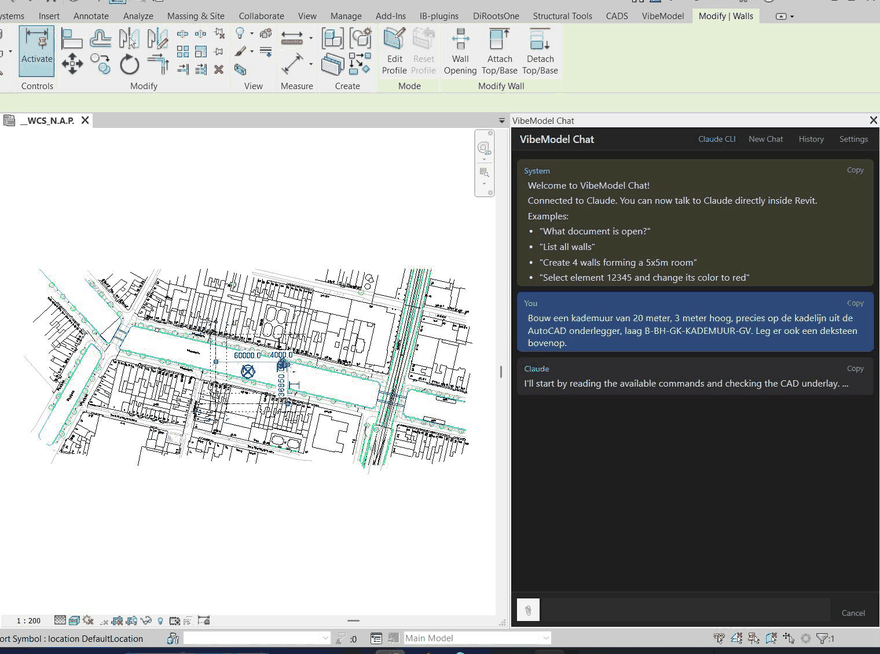
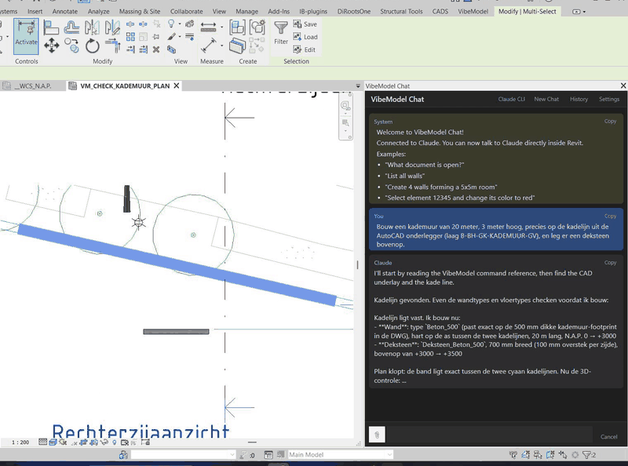

<div align="center">

# VibeModel

**Talk to your Revit model.**

An add-in that puts an AI chat panel inside Revit. Ask in plain language, watch it work, keep what you like. Every change is one Ctrl+Z.

[](https://github.com/Quincy987/VibeModel/releases)
[](#requirements)
[](#license)
[](#building-from-source)



<sub>A quay wall asked for in the chat, drawn on the imported drawing's quay line, then a capstone question. Seven seconds, time-lapsed.</sub>

</div>

---

## Why

Revit work is full of small questions with slow answers: *why can't I see this beam, how many piles have this rake, put these four views on an A0, what does the office manual say about phases.* VibeModel answers them in the model itself, and does the work when you ask it to.

- **It reads before it guesses.** Visibility settings, DWG linework, point-cloud ground levels, the project's PDFs, the office standards pack.
- **It shows its work.** Every step appears live while it runs. Every fact taken from a document or the standards carries a source marker. Every change lands in a project journal.
- **It stays reversible.** One request is one Revit undo step, even when it took twenty commands.
- **It speaks your language.** It replies in the language you write in; the panel's own texts come in English and Dutch.

## Quick start

1. **Download** the [latest release](https://github.com/Quincy987/VibeModel/releases) and unzip it.
2. **Run `install.ps1`** (right-click → *Run with PowerShell*). It finds your Revit versions and copies the files.
3. **Open Revit**, click **VibeModel → Chat**, and type. An empty chat shows the open model, its project folder and four starter prompts.

Connect it to Claude in one of two ways: a **Claude Code** subscription (recommended, auto-detected) or an **Anthropic API key** pasted into *Settings*. A local LLM works too. Details under [Installation](#installation).


## What you can say

```
What's in this model?
Why can't I see this beam in my project?
Which walls are the longest? Put them in a table with lengths and phases
Put piles along this line, every 2.8 m, turned with the line
Cut a section through this wall and put it on the sheet at 1:50
Make me a pile schedule and export the sheet as a PDF
Remember: new sections get phase 2
```

## What it can do

Nine kinds of work, with an honest status as of v1.2.8. Each topic gets a short demo video; the scripts and links live in [docs/demos](docs/demos/README.md).

| | Topic | Status |
|---|---|---|
| 1 | **Questions** — *"How do I set the view range so I can see the foundations?"* | ✅ General Revit, your office manual per chapter, the project's own documents. Tip: don't ask *how*, ask *do*. |
| 2 | **Information** — *"How many piles have this rake?"* | ✅ Count, filter, measure, real Revit schedules; DWG layers and point-cloud ground read directly. 🟡 Only if the data is in the model. |
| 3 | **Diagnosis** — *"Where did my capstone go? Why won't it join?"* | ✅ The strongest part. `whyhidden` walks every visibility gate and names the fix; `join` explains refusals; `check` audits the office rules; `sheetinfo` finds overlaps and empty stamp fields. |
| 4 | **Modelling** — *"Draw a wall along this line and cut a section through it"* | ✅ Walls, floors, families with type, rotation, parameters, placed along a line; sections, crops, aimed 3D views, callouts; one batch = one Ctrl+Z. ❌ Composite profiles, sweeps, in-place families. |
| 5 | **Sheets** — *"Put these views on an A0 so they fit"* | ✅ Sheet, stamp, grid or band layout, scale advice, move between sheets. 🟡 You decide the layout. ❌ Legends (the API can't create them). |
| 6 | **Annotating** — *"Add the levels and the sheet-pile length from the spec"* | ✅ Dimensions, level strings, text with leaders, tags, filled regions, detail items. 🟡 From a specification: a first pass. ❌ Keynotes, dimensions in 3D. |
| 7 | **Checking against a document** — *"Does the number of bolts match the specification?"* | 🟡 Reads the PDF, counts, compares, cites sources, journals the result. Still a signal, not proof. ❌ Automatic drawing-vs-model comparison. |
| 8 | **Context** — what it knows about your project and office | ✅ Project folder, office standards pack, project memory across chats, journal of changes. |
| 9 | **Exchange** | ✅ Screenshots of any view or sheet; PDF, DWG and IFC export. |

<div align="center">

<br><sub>Diagnosis in the same chat: a stray colour override found and removed, then a question about a view that suddenly looks coarse.</sub>
</div>

## How it works


VibeModel runs a small HTTP server inside Revit on `127.0.0.1:18884`. The chat backend (Claude Code, the Anthropic API or a local model) calls it with plain commands; each command runs on Revit's main thread inside a transaction and returns text or JSON. The same API works from any terminal:

```bash
curl -s http://localhost:18884/health                       # is it running?
curl -s http://localhost:18884/help                         # every command
curl -s "http://localhost:18884/whyhidden?args=348122"      # why can't I see this one?
curl -s "http://localhost:18884/wall?args=0 0 5000 0 3000"  # a wall, in mm
```

Close to eighty commands cover reading, diagnosing, modelling, sheets, annotation, office standards, project documents, memory and export. The full reference, with every flag, is in [CLAUDE.md](CLAUDE.md).

## Installation

### Requirements

- Autodesk Revit 2022 or newer (Windows)
- One way to reach Claude: a [Claude Code](https://docs.anthropic.com/en/docs/claude-code) subscription, an [Anthropic API key](https://console.anthropic.com/), or a local LLM server ([setup notes](docs/LOCAL_LLM_SETUP.md))

<details>
<summary><b>Option A — Claude Code (recommended)</b></summary>

1. Install Node.js, then `npm install -g @anthropic-ai/claude-code`
2. Run `claude` once in a terminal and log in
3. Start Revit. VibeModel detects Claude Code automatically.

This gives the chat file access to the project folder, cost tracking and the longest context.
</details>

<details>
<summary><b>Option B — Anthropic API key (pay-per-use)</b></summary>

1. Get a key from [console.anthropic.com](https://console.anthropic.com/)
2. In Revit, open the chat panel → **Settings** → paste the key

No Node.js needed. Some extras (project-folder file access, cost tracking) are Claude Code only.
</details>

<details>
<summary><b>Manual installation</b></summary>

1. Download and unzip the release. Copy `VibeModel.dll`, `VibeModel.addin`, `Markdig.dll` and the `VibeModel.PdfText` folder into
   ```
   %APPDATA%\Autodesk\Revit\Addins\{year}\
   ```
   with `{year}` your Revit version (`2023`, `2024`, …). Create the folder if it doesn't exist.
2. **Unblock the DLLs.** Windows blocks files downloaded from the internet. Right-click each `.dll` → *Properties* → *Unblock*, or in PowerShell:
   ```powershell
   Get-ChildItem "$env:APPDATA\Autodesk\Revit\Addins\*\*.dll" -Recurse | Unblock-File
   ```
3. Restart Revit. A **VibeModel** tab appears in the ribbon.
</details>

<details>
<summary><b>Settings worth knowing</b></summary>

All in the chat panel's **Settings**:

- **Language** — the fallback reply language and the panel's own texts (English or Dutch).
- **Project folder** — where the model's documents live; defaults to the folder of the open `.rvt`.
- **Standards pack folder** — an office standards pack (phases, view templates, library, checks, manual). See [standards/README.md](standards/README.md) and the sample pack in `standards/example-office/`.
- **Project memory & journal** — on by default; writes `VibeModel\memory.md` and `VibeModel\journal.md` next to the project documents.
- Optional: set `VIBEMODEL_TOKEN` before starting Revit to require a token on every API call.
</details>

## Building from source

```powershell
git clone https://github.com/Quincy987/VibeModel.git
cd VibeModel
.\build.ps1                      # Revit 2023: closes Revit, builds, deploys, restarts
.\build.ps1 -RevitVersion 2024   # another version
dotnet test VibeModel.sln -p:RevitVersion=2023   # the unit tests, no Revit needed
```

Adding a command is one file: implement `IClaudeCommand` in `src/VibeModel/Services/Claude/Commands/` and build; it is discovered by reflection and shows up in `help`, in the chat's tool list and in the step labels. The developer reference is [CLAUDE.md](CLAUDE.md); design notes per feature are in [docs/plans](docs/plans/).

## Troubleshooting

<details>
<summary><b>The VibeModel tab doesn't appear</b></summary>

All files must be in the add-ins folder for *your* Revit year, and the DLLs must be unblocked (see manual installation). Then restart Revit. If Revit shows *External Tool Failure* / `0x80131515`, the DLLs are still blocked.
</details>

<details>
<summary><b>The chat says it is not connected</b></summary>

Claude Code: run `claude --version` in a terminal; if it fails, reinstall and log in. API key: open **Settings** and check the key. Logs are in `%LOCALAPPDATA%\VibeModel\logs\`.
</details>

<details>
<summary><b>Connection refused or the wrong port</b></summary>

Port 18884 is the default; a second Revit instance falls back to 18885–18888. Each live server writes its port to `%LOCALAPPDATA%\VibeModel\servers\<port>.json`. From scripts, use `127.0.0.1` rather than `localhost`. If no port is free at all, VibeModel falls back to a file-based mode (slower, still works).
</details>

<details>
<summary><b>Commands return errors</b></summary>

Open a project first (not the start screen), and check that the element you name still exists. Every error names the cause and, where there is one, the fix.
</details>

## License

[Mozilla Public License 2.0](https://www.mozilla.org/MPL/2.0/)
