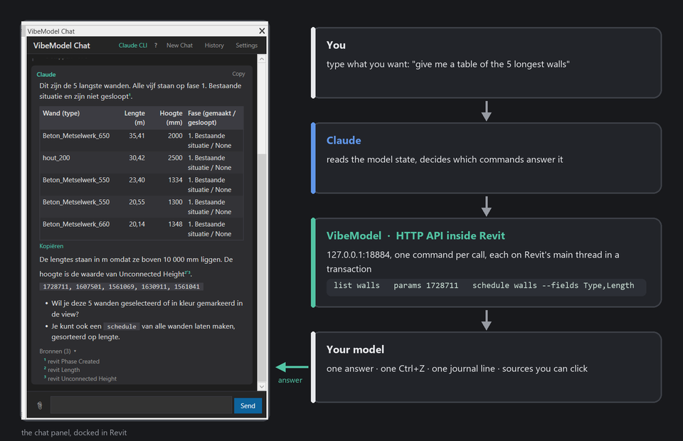

<div align="center">

# VibeModel

**Talk to your Revit model.**

An add-in that puts an AI chat panel inside Revit. Ask in plain language, watch it work, keep what you like. Every change is one Ctrl+Z.

[](https://github.com/Quincy987/VibeModel/releases)
[](#requirements)
<!-- The licence is a pending decision of the owner; the LICENSE file is not in the repo yet. -->
[](#license)
[](https://github.com/Quincy987/VibeModel/actions/workflows/ci.yml)

</div>

https://github.com/user-attachments/assets/f0ce4493-641e-4ac3-a2cd-503215edaa36

<div align="center"><sub>One request, in English: "Build a 20 m quay wall on the quay line of the drawing … wall, foundation slab, two rows of piles and a capstone." Real screen recording of v1.2.9; only the wait is sped up 6x (red badge = real seconds). <a href="https://github.com/Quincy987/VibeModel/releases/tag/demo-videos-2026-10">All videos</a>.</sub></div>

---

## Why

Revit work is full of small questions with slow answers: *why can't I see this beam, how many piles have this rake, put these four views on an A0, what does the office manual say about phases.* VibeModel answers them in the model itself, and does the work when you ask it to.

- **It reads before it guesses.** Visibility settings, DWG linework, point-cloud ground levels, the project's PDFs, the office standards pack.
- **It shows its work.** Every step appears live while it runs. Every fact taken from a document or the standards carries a source marker. Every change lands in a project journal.
- **It stays reversible.** One request is one Revit undo step, even when it took twenty commands.
- **It speaks your language.** It replies in the language you write in; the panel's own texts come in English and Dutch.

## Quick start

No administrator rights, no terminal, no Node.js.

1. **Download** `VibeModel-v<version>-Revit2023.zip` from the [latest release](https://github.com/Quincy987/VibeModel/releases/latest) (under *Assets* — not *Source code*) and unzip it.
2. **Close Revit and double-click `install.cmd`.** It installs the add-in for your Windows account, unblocks the files and checks the result. Nothing to fill in.
3. **Open Revit**, click **VibeModel → Chat**. The first time, the chat shows **Connect to Claude**: paste the API key you got from your administrator (tested on the spot, stored encrypted), or install and log in to Claude Code with one click.

Something not working? **Diagnose** in the chat header produces a report to send to whoever supports you. Rolling it out to a whole office is in [docs/deployment.md](docs/deployment.md).


## What you can say

```
What's in this model?
Why can't I see this beam in my project?
Which walls are the longest? Put them in a table with lengths and phases
Put piles along this line, every 2.8 m, turned with the line
Cut a section through this wall and put it on the sheet at 1:50
Make me a pile schedule and export the sheet as a PDF
Remember: new sections get phase 2
```

## What it can do

Nine kinds of work, with an honest status as of v1.2.10. Five topics have a live screen recording folded under the table (Dutch prompts; the full videos are in the <a href="https://github.com/Quincy987/VibeModel/releases/tag/demo-videos-2026-10">demo-videos release</a>); the scripts and the rest live in [docs/demos](docs/demos/README.md).

| | Topic | Status |
|---|---|---|
| 1 | **Questions** — *"How do I set the view range so I can see the foundations?"* | ✅ General Revit, your office manual per chapter, the project's own documents. Tip: don't ask *how*, ask *do*. |
| 2 | **Information** — *"How many piles have this rake?"* | ✅ Count, filter, measure, real Revit schedules; DWG layers and point-cloud ground read directly. 🟡 Only if the data is in the model. |
| 3 | **Diagnosis** — *"Where did my capstone go? Why won't it join?"* | ✅ The strongest part. `whyhidden` walks every visibility gate and names the fix; `join` explains refusals; `check` audits the office rules; `sheetinfo` finds overlaps and empty stamp fields. |
| 4 | **Modelling** — *"Draw a wall along this line and cut a section through it"* | ✅ Walls, floors, families with type, rotation, parameters, placed along a line; sections, crops, aimed 3D views, callouts; one batch = one Ctrl+Z. ❌ Composite profiles, sweeps, in-place families. |
| 5 | **Sheets** — *"Put these views on an A0 so they fit"* | ✅ Sheet, stamp, grid or band layout, scale advice, move between sheets. 🟡 You decide the layout. ❌ Legends (the API can't create them). |
| 6 | **Annotating** — *"Add the levels and the sheet-pile length from the spec"* | ✅ Dimensions, level strings, text with leaders, tags, filled regions, detail items. 🟡 From a specification: a first pass. ❌ Keynotes, dimensions in 3D. |
| 7 | **Checking against a document** — *"Does the number of bolts match the specification?"* | 🟡 Reads the PDF, counts, compares, cites sources, journals the result. Still a signal, not proof. ❌ Automatic drawing-vs-model comparison. |
| 8 | **Context** — what it knows about your project and office | ✅ Project folder, office standards pack, project memory across chats, journal of changes. |
| 9 | **Exchange** | ✅ Screenshots of any view or sheet; PDF, DWG and IFC export. |

<details><summary><b>The longer version</b> — a quay wall in three questions (Dutch)</summary>

https://github.com/user-attachments/assets/0265c762-6a13-4089-b537-b8c73ea619e8

<sub>Dutch: a quay wall as an L-wall on the base map's quay line (wall, foundation slab, capstone); two pile rows under the slab; then a 1:50 section with level marks. The wait is sped up 6x.</sub>

</details>

<details><summary><b>Diagnosis</b> — see it</summary>

https://github.com/user-attachments/assets/55419990-a25a-4d80-a5e4-3ef0f78f13ce

<sub>Dutch: “I can't see the capstone in this 3D view any more. Why not? Put it back.” The chat reads the view's visibility gates, names the cause (hidden in view) and unhides it.</sub>

</details>

<details><summary><b>Information</b> — see it</summary>

https://github.com/user-attachments/assets/35ad70df-1da9-48c8-9dd9-456ba4dc13ac

<sub>Dutch: a point cloud over the model; “read the ground level along the new wall every 2 m” gives a table and a 3D view with the scan; “let the capstone top follow that” shape-edits the slab and opens a longitudinal section.</sub>

</details>

<details><summary><b>Modelling</b> — see it</summary>

https://github.com/user-attachments/assets/51adf70b-6ffc-46f9-8359-7a446694db9a

<sub>Dutch: “expansion joint every 10 m, 20 mm, with an elevation and a text label”; “replace the wooden piles by concrete piles 320x320, raked 1:5 outwards, numbered P01–P40”; “place a drowning-ladder recessed in the wall”. Each answer opens the view it made.</sub>

</details>

<details><summary><b>Sheets</b> — see it</summary>

https://github.com/user-attachments/assets/9c71a615-0444-4a4b-9e0d-dfff79a2a065

<sub>Dutch: “a pile schedule with number, type and rake”; “add the level marks to section 1-1”; “put section, elevation, the 3D of the piles and the schedule on a new A0 sheet, check that everything fits, export it as PDF”.</sub>

</details>

<details><summary><b>Context</b> — see it</summary>

https://github.com/user-attachments/assets/55be1a79-64a6-410a-b158-f4e6caf4d64c

<sub>Dutch: “which documents are in the project folder and what does the safety memo say?”; “remember: sections get phase 2 and the capstone is 200 mm”; “what was done in this model today?” — answered from the journal.</sub>

</details>

## How it works



VibeModel runs a small HTTP server inside Revit on `127.0.0.1:18884`. The chat backend (Claude Code, the Anthropic API or a local model) calls it with plain commands; each command runs on Revit's main thread inside a transaction and returns text or JSON. The same API works from any terminal:

```bash
curl -s http://localhost:18884/health                       # is it running?
curl -s http://localhost:18884/help                         # every command
curl -s "http://localhost:18884/whyhidden?args=348122"      # why can't I see this one?
curl -s "http://localhost:18884/wall?args=0 0 5000 0 3000"  # a wall, in mm
```

Close to eighty commands cover reading, diagnosing, modelling, sheets, annotation, office standards, project documents, memory and export. The full reference, with every flag, is in [CLAUDE.md](CLAUDE.md).

## Your own standards

VibeModel does not know how your office models. You tell it with a **standards pack**: a folder of plain markdown and JSON that the person who owns your Revit standard maintains, no code involved.

1. **Copy the sample.** `standards/example-office/` is a complete, fictional pack: `pack.json` (phases, view templates, title block, library paths, link settings), `core.md` (the rules every chat turn gets), topic sheets (`topics/phasing.md`, `sheets.md`, …) and `checks.json` (what `check` audits).
2. **Fill in your office.** Your phase names, your view templates, where your family library lives, which parameters must be filled. Drop your modelling manual (PDF) next to it and run `standards --index` once: the chat can then quote it by chapter and cite it.
3. **Point VibeModel at it.** Settings → *Standards pack folder* → your office share. Every modeller gets the same pack without a new add-in release; the add-in mirrors it to the local machine, so a missing VPN only means yesterday's pack stays in force.

https://github.com/user-attachments/assets/01549e12-8f9f-47ff-ae17-dba4e2b72a42

<sub>Dutch, with a real office pack: “check this model against the office standard and colour the problems red”; “fill the BIM-ID fields and check again”; “put a temporary sheet-pile cofferdam 3 m behind the wall in the temporary-works phase”.</sub>

A pack only switches on for models that match its **fingerprint** (your phases and a shared parameter), so a stranger's model is never judged by your rules. And your pack stays yours: it lives on your share and your machines, never in this repository. The full format is in [standards/README.md](standards/README.md).

## Installation

### Requirements

- Autodesk Revit 2022, 2023 or 2024 on Windows (built and verified on 2023). The add-in targets .NET Framework 4.8; Revit 2025 and newer run on .NET 8 and cannot load it yet
- One way to reach Claude: an [Anthropic API key](https://console.anthropic.com/) (what an office hands out), a [Claude Code](https://code.claude.com/docs/en/setup) subscription, or a local LLM server ([setup notes](docs/LOCAL_LLM_SETUP.md))
- No administrator rights: everything installs for the signed-in Windows user

<details>
<summary><b>Option A — API key (recommended for an office)</b></summary>

1. Get a key from your administrator (or [console.anthropic.com](https://console.anthropic.com/))
2. In Revit: **VibeModel → Chat** → *Connect to Claude* → paste it → **Save and start**

The key is checked against the API before it is stored (no tokens spent), then kept DPAPI-encrypted for your Windows account only — never as plain text. The chat goes through the Windows proxy with your Windows credentials. Under each answer a muted line shows the tokens it used and an estimate of the cost (`12.3k tokens · ≈ €0,04`).
</details>

<details>
<summary><b>Option B — Claude Code (your own Claude subscription)</b></summary>

In the *Connect to Claude* card: **Install** runs Anthropic's per-user installer (`irm https://claude.ai/install.ps1 | iex`, no administrator rights) in a visible window; **Log in** opens Claude Code once so you can sign in with your Claude account in the browser; **Use Claude Code** switches the chat over. Already installed? It is found in `%USERPROFILE%\.local\bin`, on the PATH (read fresh, so no restart is needed after installing) or in the old npm folders. Git for Windows is not needed — without it Claude Code uses PowerShell, which VibeModel allows.

Claude Code adds file access to the project folder and the longest context.
</details>

<details>
<summary><b>Manual installation</b></summary>

1. Download and unzip the release zip (`VibeModel-v<version>-Revit2023.zip`). Copy `VibeModel.dll`, `VibeModel.addin`, `Markdig.dll` and the `VibeModel.PdfText` folder into
   ```
   %APPDATA%\Autodesk\Revit\Addins\{year}\
   ```
   with `{year}` your Revit version (`2023`, `2024`, …). Create the folder if it doesn't exist.
2. **Unblock the DLLs.** Windows blocks files downloaded from the internet. Right-click each `.dll` → *Properties* → *Unblock*, or in PowerShell:
   ```powershell
   Get-ChildItem "$env:APPDATA\Autodesk\Revit\Addins\*\*.dll" -Recurse | Unblock-File
   ```
3. Restart Revit. A **VibeModel** tab appears in the ribbon.

An unsigned build makes Revit ask once per version whether to load it (*Always Load*). A build signed with a certificate your computer trusts loads without asking; see [docs/deployment.md](docs/deployment.md#signing).
</details>

<details>
<summary><b>Settings worth knowing</b></summary>

All in the chat panel's **Settings**:

- **Language** — the fallback reply language and the panel's own texts (English or Dutch).
- **Project folder** — where the model's documents live; defaults to the folder of the open `.rvt`.
- **Standards pack folder** — an office standards pack (phases, view templates, library, checks, manual). See [standards/README.md](standards/README.md) and the sample pack in `standards/example-office/`.
- **Project memory & journal** — on by default; writes `VibeModel\memory.md` and `VibeModel\journal.md` next to the project documents.
- Optional: set `VIBEMODEL_TOKEN` before starting Revit to require a token on every API call.
</details>

## Building from source

```powershell
git clone https://github.com/Quincy987/VibeModel.git
cd VibeModel
.\build.ps1                      # Revit 2023: closes Revit, builds, deploys, restarts
.\build.ps1 -RevitVersion 2024   # another version
dotnet test VibeModel.sln -p:RevitVersion=2023   # the unit tests, no Revit needed
```

Adding a command is one file: implement `IClaudeCommand` in `src/VibeModel/Services/Claude/Commands/` and build; it is discovered by reflection and shows up in `help`, in the chat's tool list and in the step labels. The developer reference is [CLAUDE.md](CLAUDE.md); design notes per feature are in [docs/plans](docs/plans/).

## Troubleshooting

<details>
<summary><b>The VibeModel tab doesn't appear</b></summary>

All files must be in the add-ins folder for *your* Revit year, and the DLLs must be unblocked (see manual installation). Then restart Revit. If Revit shows *External Tool Failure* / `0x80131515`, the DLLs are still blocked.

The most common cause: the downloaded zip was GitHub's *Source code (zip)*, which contains no compiled add-in. Download the `VibeModel-v<version>-Revit2023.zip` under *Assets* instead; `install.cmd` names this when it happens, and keeps its window open so the message can be read.
</details>

<details>
<summary><b>The chat says it is not connected</b></summary>

Click **Diagnose** in the chat header: it shows which connection is in use, where the key comes from (masked), where Claude Code was looked for, the proxy, and whether `api.anthropic.com` answers — including who issued the certificate it presented, which reveals a TLS-inspecting proxy. **Copy** and send it to whoever supports you. New Chat shows the *Connect to Claude* card again. Warnings and errors are always logged in `%LOCALAPPDATA%\VibeModel\logs\` (everything with `VIBEMODEL_DEBUG=1`); the installer writes `install.log` there.
</details>

<details>
<summary><b>Connection refused or the wrong port</b></summary>

Port 18884 is the default; a second Revit instance falls back to 18885–18888. Each live server writes its port to `%LOCALAPPDATA%\VibeModel\servers\<port>.json`. From scripts, use `127.0.0.1` rather than `localhost`. If no port is free at all, VibeModel falls back to a file-based mode (slower, still works).
</details>

<details>
<summary><b>Commands return errors</b></summary>

Open a project first (not the start screen), and check that the element you name still exists. Every error names the cause and, where there is one, the fix.
</details>

## Limitations & privacy

- Windows only, Revit 2022–2024 (see [Requirements](#requirements)).
- Needs an Anthropic API key, a Claude Code subscription or a local LLM server; nothing works offline without one.
- Your question, the model data the assistant asks for (element lists, parameters, geometry), screenshots of views and the text it quotes from project and office documents are sent to the LLM provider you configured. With a local LLM nothing leaves your machine.
- The local HTTP server listens on loopback only, but its `exec` command runs any C# the signed-in user could run; other processes on the same machine can call it unless you set `VIBEMODEL_TOKEN`. Details and how to report a vulnerability: [SECURITY.md](SECURITY.md).

## Contributing

Bugs: open an [issue](https://github.com/Quincy987/VibeModel/issues/new/choose) with the Diagnose report (chat header → **Diagnose** → **Copy**), your Revit year and what you asked.
Pull requests go against the `development` branch; `dotnet test VibeModel.sln -p:RevitVersion=2023` must stay green (CI runs it on every push).

## License

<!-- LICENSE file pending: the owner has not yet finalised the licence. Keep this section and badge as they are until then. -->
[Mozilla Public License 2.0](https://www.mozilla.org/MPL/2.0/)
