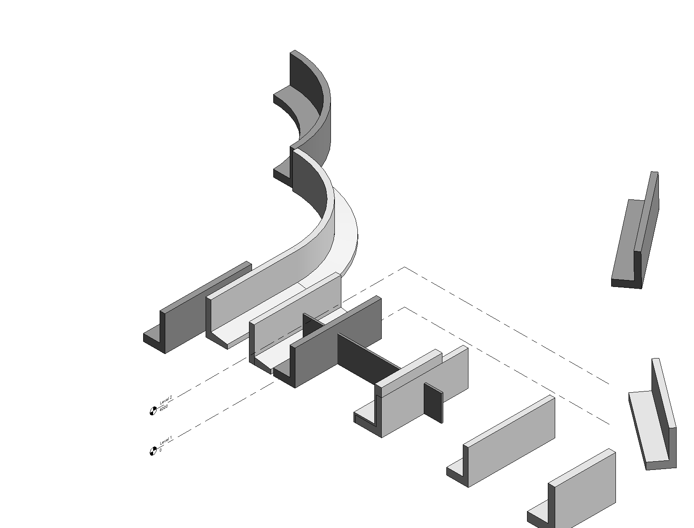
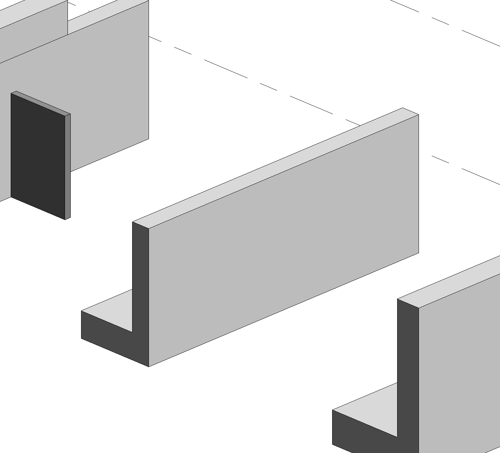
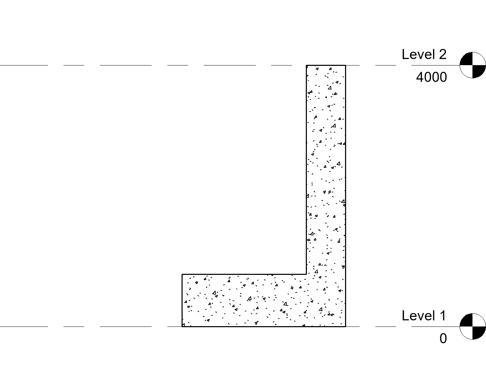

# Plan 12 — Composite Profiles: quay walls, capstones, aprons as real Revit families

> Goal: close the last ❌ in README §4 "Modelling". A quay wall as an L-wall (with a sloped
> foot), a capstone with a chamfered profile, a sheet-pile wall as a repeated profile, a
> concrete apron ("betonschort"), sweeps along a curved canal — built from the chat as
> **parametric, schedulable elements with a family and a type**, not as ad-hoc `exec`
> DirectShapes (the workshop corner stone, id 3114013, has no family/type and never shows up
> in a schedule).

> **STATUS (research — not built).** Every route below was probed live on 2026-10-13 in
> Revit 2023.1 (add-in v1.2.8, b716df4), in a fresh project from `DefaultMetric.rte`, in a
> second Revit instance so the user's open model was never touched. Probe scripts:
> `.verify/profiles/p01…p17*.cs` (gitignored, local); the numbers quoted here are their
> output. No command in `src/` was added. The recommended route is proved end to end in §4.

## TL;DR

1. **Generate a real family on the fly** — `Application.NewFamilyDocument(<template>)`, one
   extrusion of the 2D profile, its faces locked to reference planes, save the `.rfa` into the
   project folder, `doc.LoadFamily(path)` and place. Takes ~1 s, runs **inside the command's own
   transaction** (one Ctrl+Z), and gives an element that schedules by type with a correct
   Volume, joins with walls, carries phase and the office shared parameters, and that the user
   can open with *Edit Family* / *Type Properties* like any library family.
2. **Line-based Generic Model** (`Metric Generic Model line based.rft`) is the workhorse for
   straight runs: the length follows the placement line, the profile lives in the family's
   vertical plane, and the L sizes can be **type parameters** (stem width, height, foot width,
   foot thickness) — probed: two types, 39.20 m³ and 44.80 m³, both exact.
3. Curves: a **sweep along a baked path** in a point-based Generic Model (probed on a quarter
   arc, volume exact) or an **adaptive component** (2 points, follows a slope). A wall type
   with an integrated sweep follows arcs too, but its Volume ignores the sweep.
4. **Don't**: DirectShape(+Type) (schedules by type name but no Volume, refuses joins),
   line-based family re-categorised to Structural Foundations (placement is silently lost),
   in-place families (no API exists).
5. Commands: `profile` (a named profile, stored as a Revit Profile family), `extrude`
   (profile along a line), `sweep` (profile along a curve chain), and the convenience
   `lwall` built on the same builder. One new pack block (`profiles`) and one topic sheet
   (`kadeconstructie`) whose content the office fills in.

---

## 1. The routes, probed

### 1.1 Matrix

| Route | Schedules by type | Quantities in schedule | Join with wall | Phase + office shared param | Edit in Revit UI | Undo | Verdict |
|---|---|---|---|---|---|---|---|
| (b) **line-based GM family**, generated | ✅ `VM_Kademuur L GM : 600x4000 voet 2500x800` | Volume ✅; length only via a shared param (§1.3) | ✅ joined, family cuts the wall | ✅ / ✅ | ✅ Edit Family, Type Properties | 1 step | **Recommended (straight)** |
| (b) point-based **Structural Foundation** family, instance "Wall length" | ✅ | Volume ✅ 39.20 m³ | not probed (same class as above) | ✅ / ✅ | ✅ | 1 step | Recommended when the office wants foundations |
| (b) line-based family re-categorised to Structural Foundations | ✅ | Volume ✅ | ✅ | ✅ / ✅ | ✅ | 1 step | ❌ **instance ignores its line** (§1.2) |
| (b) Structural Framing family with the L as section | ✅ | Length, Cut Length, Volume ✅ | not probed | ✅ / ✅ | ✅ | 1 step | Works; beam semantics (analytical line, z = top at the curve) — not for walls |
| (b) GM family with a **sweep along an arc** (baked path) | ✅ | Volume ✅ 56.74 m³ (= 3.92 m² × centroid arc) | not probed | ✅ / ✅ | ✅ | 1 step | **Recommended (curved)**, path fixed per family |
| (c) **adaptive** GM, 2 placement points, swept-blend form | ✅ | Volume ✅ 39.40 m³ over a 10.05 m sloped line | not probed | ✅ phase | ✅ (massing editor) | 1 step | Works, follows slopes; heavier to edit; phase 2 |
| (d) DirectShape **with DirectShapeType** | 🟡 shows `Direct Shape: Kademuur L DS` | ❌ Volume empty | ❌ "The elements cannot be joined" | ✅ / ✅ | ❌ no editing | 1 step | Not a solution — only a label |
| (a) generated **Profile family + WallSweep** on a 600 wall | ✅ (Wall Sweeps) | Length, Material ✅; no Volume field | — (it is part of the wall) | ✅ / ✅ | ✅ | 1 step | Good for a *foot on an existing wall*; two elements |
| (e) wall type with the foot as **integrated sweep** (compound structure) | ✅ as Walls | ❌ Volume 24.00 m³ = stem only, foot not counted | ✅ (walls) | ✅ / ✅ | ✅ Edit Type → Sweeps | 1 step | Follows arcs, but wrong quantities |
| (e) Parts | — | — | — | — | — | — | Not a creation route: `PartUtils.AreElementsValidForCreateParts` is true for every result above, so Parts stay available *downstream* (pour sections) |
| In-place family | — | — | — | — | — | — | ❌ no API: reflection finds only `Family.IsInPlace` (read-only) |

"Office shared param" = a stand-in instance parameter `OFFICE_Objectcode` bound to Generic
Models, Structural Foundations, Structural Framing, Walls, Wall Sweeps and Parts in the probe
project (the real pack's fingerprint parameter behaves the same: it is a project binding, so
any family instance of a bound category carries it). "1 step": the stamp's `edits` counter went
up by exactly one per command that generated + loaded + placed (`model #1 → #2`, `#2 → #3`);
the family document's own transactions never reach the project's undo stack.



### 1.2 Findings per route

**(b) Generated line-based Generic Model** — `p02`, `p05`, `p11b`, `p12b`.
- Template planes: `Left` (x = 0) and `Right` (x = Length), instance parameter `Length`.
  Draw the profile in the plane x = 0 (family +Y = horizontal, +Z = up), `NewExtrusion` it,
  then `NewAlignment` the −X face to `Left` and the +X face to `Right`, both locked. Flex test
  in the family: Length 5000 → extrusion x 0..5000.
- Placed with `doc.Create.NewFamilyInstance(Line, symbol, level, NonStructural)`: a line along +X
  gives y 0..2500, i.e. **family +Y = left of the line direction** — the same side `section`
  looks to. A diagonal 10 m line placed correctly (bbox x 12000..20000).
- Parametric profile (`p11b`): four reference planes in the `Left` elevation (stem back, toe,
  foot top, top), four dimensions labelled with type parameters, all eight faces aligned and
  locked. Flex stem 800 / foot 3200×1000 / H 5000 / L 7000 → 44.800 m³, exact. In the project,
  type `600x4000 voet 2500x800` = 39.20 m³ over 10 m and a duplicated type
  `800x5000 voet 3200x1000` = 44.80 m³ over 7 m.
- Material: a type parameter `Material` associated with the extrusion's material; set in the
  project → the section shows the concrete cut pattern (§4).
- Generation + save: 946–1033 ms per family.

**Structural Foundations** — `p02`, `p13`, `p14`.
- Re-categorising the line-based template is *accepted* by the API (`FamilyCategory = …`) and
  even flexes in the family, but in the project **every instance sits at the project origin,
  unrotated** (lines from (0,−10000), (0,5000) and a diagonal from (3000,8000) all produced
  geometry at y 0..2500 from the origin; a second, empty `Length` = `CONTINUOUS_FOOTING_LENGTH`
  appears next to the line length). Never do this.
- The point-based `Metric Structural Foundation.rft` works: add a reference plane `End`, an
  instance parameter `Wall length` labelling `Center (Left/Right)`→`End`, extrude, lock both
  ends. Placed at a point, `Wall length` = line length, rotated with `RotateElement` → correct
  position (bbox x 28000..36000), Volume 39.20 m³. Associating the extrusion's material with the
  template's `Structural Material` made regeneration fail — use an own `Material` parameter.

**Structural Framing** — `p09`. Delete the template's rectangle, extrude the L between
`Member Left`/`Member Right`, lock. Gives Length, Cut Length, Volume and Structural Material
for free, but it is a *beam*: an analytical member, stick symbols at
coarse detail, and the top of the section sits at the curve's z (`Elevation at Top 0`,
`at Bottom −4000`, `Reference Level` taken from the curve, not the level passed in). Right for
a capping beam or a waling, wrong for a wall.

**Sweep along a curve** — `p10`. Generic Model family, `NewSweep(path = arc, profile in XY,
ProfilePlaneLocation.Start)`, family origin = path start, instance placed there. Profile +u
again lands on the left of the travel direction. One family per path: moving the path means
re-running the command.

**Adaptive** — `p17`. Two placement points, a reference `CurveByPoints` between them, the L
as six `CurveByPoints` on points hosted on point 1's YZ plane, `NewSweptBlendForm(path, [profile])`.
Instance via `AdaptiveComponentInstanceUtils`, points moved to (30000,0,0) and (38000,6000,1000):
the wall follows the slope (z 0..4980), Volume 39.40 m³ = 3.92 m² × 10.05 m. Useful for a quay
that ramps; editing means the massing editor, which modellers rarely use.

**DirectShape + DirectShapeType** — `p07`. `DirectShapeType.Create(doc, "Kademuur L DS", GM)`,
`ds.SetTypeId`. The schedule shows `Direct Shape: Kademuur L DS` (so it *does* group by type),
but Volume is empty, no Material parameter, and `join` with a wall is refused by Revit. It
remains a picture with a name.

**Wall sweep / integrated sweep** — `p08`.
- The profile family (`Metric Profile.rft`, four detail curves in the `Ref. Level` plan; a
  sloped foot 1900 wide, 800 at the face, 500 at the toe) loads fine.
- A standalone `WallSweep` **ignores `WallSweepInfo.ProfileId`**: the profile is a parameter of
  the sweep *type*. First attempt produced the template's 152 mm cornice; duplicating the type
  and setting its `Profile` + `Material` gave the right foot (12.35 m³ = 1.235 m² × 10 m).
  Schedulable as Wall Sweeps with Length, Material, Profile — no Volume field.
- An integrated sweep needs the *fixed* constructor `new WallSweepInfo(true, WallSweepType.Sweep)`
  (the other one throws "Only fixed wall sweeps may be assigned to vertical compound
  structures"). The wall then shows the foot (bbox 2500 wide), follows an arc, but its Volume is
  24.00 m³ = the stem alone.

### 1.3 API recipe and traps (what a builder must know)

- **Face references: `new Options { ComputeReferences = true }` without `View`.** With
  `View = plan` the first `NewAlignment` crashed Revit's native code (`SEHException`); in a 3D
  view `NewAlignment` fails ("Failed to create the alignment"); plan or front elevation work.
- **Regenerate after creating reference planes**, before dimensioning them — otherwise
  `NewDimension` throws "The references are not geometric references".
- **Load from the saved file, inside the transaction.** `doc.LoadFamily(path, opts, out fam)`
  works with the command's transaction open (one undo step). `familyDoc.LoadFamily(projectDoc)`
  is refused: "The document must not be modifiable before calling LoadFamily". A family document
  can be created, edited and saved while the project transaction is open.
- **Reload = update, never "(2)".** `LoadFamily(path)` *without* options on an existing family
  returns false and changes nothing. With an `IFamilyLoadOptions` returning
  `overwriteParameterValues = true` the geometry updates but project-side type values are reset
  (Material went back to `<By Category>`); with `false` the geometry updates, project types and
  their values stay, and new family parameters (here `VM_Length`) appear on existing instances.
  Side effect: the family's own default type re-appears if the project renamed it — so name the
  family's type exactly as the project type will be named.
- **Length in a schedule** needs a *shared* parameter: the line-based `Length` is a family
  parameter and not schedulable for Generic Models (`schedule` refused `Length` and `Material`).
  A shared instance parameter `VM_Length` with formula `= Length` fixed it (`10000`, `7000`,
  grand total `27000`). Adding a shared parameter requires setting
  `Application.SharedParametersFilename`, an **application-wide user setting** — the builder
  must restore the previous value in a `finally`.
- Old-C# `exec` cannot declare an `IFamilyLoadOptions`; the probes closed the wrapper's method
  early to add a class (`.verify/profiles/loadopts_tail.txt`). The real command has no such
  problem — noted only so nobody repeats the probes the hard way.

---

## 2. Command design

### 2.1 Profile convention (shared by every command)

A profile is a closed polygon in **millimetres** in a vertical plane across the run:
**u** = horizontal, perpendicular to the line, **positive to the LEFT of the direction
x1,y1 → x2,y2** (the side `section` looks to; verified for line-based families and sweeps),
**v** = up, from the line's elevation (the level + `--z`). The point (0,0) lies on the placement
line. Points are closed automatically (a repeated first point is accepted); fewer than 3
points, zero area or a self-intersecting outline is refused with the offending segment; the
winding is normalised. Lines only in phase 1 (arcs in a profile: phase 2).

### 2.2 Commands

```
profile <name> --points u,v u,v …             a named profile → Revit Profile family "<prefix><name>"
profile <name>                                 print it (points, area m², bounding box)
extrude <profile | --points u,v …> --along <line id | wall id | x1 y1 x2 y2>
        [--z <mm>] [--level <name>] [--flip] [--type <name>] [--category generic|foundation|framing]
        [--material <name>] [--phase <kind>] [--set "P=v"]…
extrude <profile> --vertical <height> --at <x y> [--rotate <deg>]      plan profile extruded upward (sheet-pile pair, block)
sweep   <profile> --along <id,id,… | wall id>  [same flags]            curve chain (lines + arcs), baked path
lwall   <x1 y1 x2 y2> --stem 600x4000 --foot 2500x800 [--toe 500] [--slope <toe mm>]
        [--side left|right] [--type <name>] [flags as extrude]
```

- **`profile`** stores the polygon as a Revit **Profile family** (detail lines, probed in `p08`)
  plus a type text parameter `VM_Profile` holding the points, so later commands read the points
  without opening the family and the same profile also works in Revit's own Wall Sweep / Slab
  Edge / Sweep tools. Re-running with the same name updates it.
- **`extrude`** builds one line-based Generic Model family per profile (`<prefix><profile>`),
  one type (`--type`, default the profile name), and places one instance along the line in the
  same transaction. `--along` reuses `place --along`'s line resolution (line id, wall/beam
  location curve, two points). `--flip` mirrors u. `--category foundation` switches to the
  point-based foundation family with an instance `Wall length` (§1.2); `framing` to the beam
  family (with the warning that it becomes an analytical member).
- **`extrude --vertical`** draws the profile in plan instead (u,v = x,y around the insertion
  point) and extrudes it upward in a point-based family — the "repeated profile" of a sheet-pile
  wall is then one pair as a family + the existing `place --along --spacing <system width>
  --rotate auto`. Preferred order stays the office's own: `library damwand` first.
- **`sweep`** chains the given curves with the existing `CurveChainer`, builds a point-based
  Generic Model family with `NewSweep` along that chain and places it at the chain start. The
  response says plainly that the path is fixed in the family ("move the line and run `sweep`
  again").
- **`lwall`** is the convenience form on one parametric family `<prefix>L-wand` (name from the
  pack): type parameters stem width, height (total, underside foot → top), foot width, foot
  thickness, toe (how far the foot sticks out in front of the stem, default 0), placed along the
  line with the heel on `--side` (default left). A new size combination becomes a new **type**
  named from the sizes (`600x4000 voet 2500x800`), an existing one is reused — never a new
  family. `--slope <mm>` (foot thickness at the toe) makes the foot top slope; parametric sloped
  faces were not probed, so phase 1 builds a sloped foot as a fixed-geometry `extrude` profile
  and says so.
- Capstone with chamfer and concrete apron are **not** extra commands: they are `profile` +
  `extrude` with points (the topic sheet holds the office's standard sections as ready profiles,
  once the office provides them). A chamfered capstone is e.g.
  `profile Deksteen --points 0,0 500,0 500,250 470,280 0,280`.

### 2.3 Families: names, storage, updates

- **Name**: `<prefix><name>`, prefix from the pack (`profiles.familyPrefix`, else `VM_`). Names
  are sanitised for Revit's forbidden characters (`\ : { } [ ] | ; < > ? ` ~`).
- **Where**: `<project folder>\VibeModel\families\<family>.rfa` — next to `memory.md` and
  `journal.md`, already excluded from `docs`. A pack may name another folder relative to the
  project folder (`profiles.folder`). Model without a folder:
  `%LOCALAPPDATA%\VibeModel\projects\<title>\families\` (the memory fallback). Writing the file
  uses the project-folder 3 s deadline; when the folder is offline the family is saved to the
  local fallback and the response says so — the model never depends on the file (the family is
  embedded once loaded).
- **Update, not "(2)"**: re-running for an existing name regenerates the file and reloads it with
  `overwriteParameterValues = false` (§1.3). Before overwriting, the command compares a hidden
  type parameter `VM_Source` (hash of profile + template + version) with the loaded family; if
  the family was changed by hand since (Edit Family → Load into Project), it refuses with "this
  family was edited in Revit; add `--replace` to overwrite those edits".
- **Undo / batch**: generate + save + load + place is one transaction → one Ctrl+Z, also inside
  `batch` (atomic included). An undone or rolled-back command leaves the `.rfa` on disk, which is
  harmless (it is regenerated next time); the `VM_Source` stamp lives in the model.
- **Templates**: in order: the pack's `profiles.familyTemplates.<kind>`, looked up in the pack's
  template folder or Revit's `FamilyTemplatePath` (on the pilot office's machines that is the
  office's own prefixed copies on a network share — read once in the background into
  `%LOCALAPPDATA%\VibeModel\standards\_cache\…`, never on the main thread without a deadline),
  then the Autodesk metric templates in `C:\ProgramData\Autodesk\RVT <ver>\Family Templates\English\`
  (present on this machine for 2023: `Metric Generic Model line based.rft`,
  `Metric Generic Model.rft`, `Metric Generic Model Adaptive.rft`, `Metric Structural
  Foundation.rft`, `Metric Structural Framing - Beams and Braces.rft`, `Metric Profile.rft`).
- **Parameters**: `Material` (type), `VM_Length` (shared, instance, `= Length`),
  `VM_Source` (type, text), the `lwall` sizes (type). The shared definitions come from a small
  shared-parameter file shipped next to the add-in with fixed GUIDs (so every generated family
  schedules into the same column), unless the pack names the office's own file + names. The
  previous `SharedParametersFilename` is always restored.
- **Phase / standards**: placement goes through `PhaseDefaults.Prepare` like `place` (default
  kind from the pack's phase table, `--phase` overrides), the post-command check runs on the new
  instance, the journal records it (`extrude Kademuur --along 4711 · created … · loaded VM_Kademuur`).

### 2.4 Response (text mode)

```
EXTRUDED
========
Family: VM_Kademuur L GM (new, Generic Models, line-based) → C:\…\VibeModel\families\VM_Kademuur L GM.rfa
Type: 600x4000 voet 2500x800 — profile 3.92 m², 2500 x 4000 mm, foot on the left (north) side
Instance: 357279 along (0, -10000) → (10000, -10000), length 10000 mm, volume 39.20 m³
Material: Concrete, Cast In Situ | phase: New Construction
Next: 'section 357279' to check the profile; 'schedule generic models --fields "Family and Type,Count,VM_Length,Volume"'.
```

---

## 3. Office standards: what a pack needs for a quay wall

`pack.json` gets an optional block (absent → the defaults above):

```json
"profiles": {
  "familyPrefix": "<office prefix>",
  "category": { "lwall": "generic|foundation", "capstone": "...", "apron": "...", "sweep": "..." },
  "familyTemplates": { "lineBased": "<file.rft>", "generic": "<file.rft>", "foundation": "<file.rft>",
                       "framing": "<file.rft>", "profile": "<file.rft>" },
  "folder": "<relative to the project folder>",
  "sharedParameters": { "file": "<path>", "length": "<name>", "objectCode": "<name>" },
  "material": { "default": "<material name>", "capstone": "<material name>" },
  "typeName": "<pattern, e.g. {stem}x{height} voet {foot}x{footThickness}>"
}
```

and a topic sheet **`topics/kadeconstructie.md`**, written by the office. What the chat needs to
find in it (a checklist, deliberately without values — those are office knowledge):

- **Reference**: which level/height system the sizes are measured from (the NAP level's name),
  which side is the water side, the placement line (front face of the stem, a grid, the
  capstone edge?).
- **Wall body**: total height or top level, stem thickness at top and bottom (batter), foot
  width, foot thickness at the stem and at the toe (slope), toe/heel split, segment (joint)
  length between dilatations.
- **Capstone**: width, height, overhang on the water side, chamfer/rounding sizes, material,
  joint length, modelled as a separate element or part of the wall.
- **Apron (betonschort)**: width, thickness, slope, connection to the wall, material.
- **Sheet piles**: library family to use, system width (pair), top and toe level rules,
  temporary or permanent.
- **Foundation**: piles under the foot (family, grid along/across, rake) — already covered by
  `place --along`; the sheet only names the family and the rules.
- **Materials**: concrete class / material name per part, finish materials.
- **Phase**: per element kind, which phase kind (existing, temporary cofferdam, new, demolish).
- **Category and naming**: which Revit category per part, family/type naming pattern,
  required shared parameters (object code etc.) and who fills them.
- **Standard sections**: optional ready profiles (`profile` point lists) for the office's
  recurring capstones and wall types, with their source document and chapter, so the chat can
  cite them (`[bron: standaard kadeconstructie]`).

The example pack (`standards/example-office/`) gets the block with fictional values and an
empty sheet with these headings; the real office sheet is the office's to write.

---

## 4. Proof: the L-profile, 10 m, scheduled by type

Fresh project (`DefaultMetric.rte`), generated parametric family `VM_Kademuur L GM`
(line-based Generic Model), type `600x4000 voet 2500x800`, placed along (0,−10000) →
(10000,−10000) on Level 1, material Concrete, Cast In Situ (`p11b`, `p12b`, `p15`, `p16`):

```
357279 Generic Models | VM_Kademuur L GM : 600x4000 voet 2500x800 | Length 10000 | vol 39.20 m³
       bbox x 0..10000 y -10000..-7500 z 0..4000
```

Volume check: (2.5 × 0.8 + 0.6 × 3.2) m² × 10 m = 39.20 m³.





`schedule generic models --fields "Family and Type,Count,VM_Length,Volume" --group Family and Type --total`:

```
Family and Type                                    | Count | VM_Length (mm) | Volume (m³)
---------------------------------------------------+-------+----------------+------------
Direct Shape: Kademuur L DS                        | 1     | 0              | 0.00 m³
VM_Kademuur bocht: VM_Kademuur bocht               | 1     | 0              | 56.74 m³
VM_Kademuur L 600x4000-2500x800: …                 | 1     | 0              | 43.20 m³
VM_Kademuur L GM: 600x4000 voet 2500x800           | 2     | 20000          | 78.40 m³
VM_Kademuur L GM: 800x5000 voet 3200x1000          | 1     | 7000           | 44.80 m³
Grand total: 6                                     |       | 27000          | 223.14 m³
```

(The DirectShape row is the route-(d) probe: listed, but no quantities. The two rows without
`VM_Length` are probe families generated before the shared parameter was added.)

### What failed along the way

- `NewAlignment` with face references computed for a view → `SEHException` (fixed: no view).
- `NewDimension` on just-created reference planes → "not geometric references" (fixed: regenerate).
- `familyDoc.LoadFamily(projectDoc)` inside the project transaction → refused.
- Reload with `overwriteParameterValues = true` reset the project's type Material.
- Line-based family re-categorised to Structural Foundations → instances at the origin.
- Structural Foundation template: material association with `Structural Material` → regeneration failed.
- Standalone `WallSweep` → the type's cornice profile instead of ours, until the sweep *type* got the profile.
- Integrated sweep with the non-fixed `WallSweepInfo` → refused; with the fixed one the wall Volume ignores it.
- DirectShape: no Volume, join refused.
- Side findings: `schedule` cannot address Wall Sweeps (the category is missing from `categories`);
  `.verify/boot_watch.py` does not know the "File Opened By Another User" dialog Revit shows when
  a second instance opens a template the first one holds (its `invoke()` did nothing; a real click did).

---

## 5. Estimate

**Files** (phase 1 = `profile`, `extrude` incl. `--vertical`/`--category`, `lwall` without
parametric slope, `sweep`):

- New, Revit-free (unit-tested): `Services/Claude/ProfileArgs.cs` (grammar of the four
  commands), `Services/Claude/ProfileGeometry.cs` (polygon validation, winding, area/centroid,
  `lwall`/chamfer polygons, type-name pattern, name sanitising, `VM_Source` hash).
- New, Revit: `Services/Claude/FamilyGen/FamilyBuilder.cs` (template resolution, extrusion /
  sweep, reference planes + labelled dimensions + locked alignments, parameters, save, always
  `Close(false)` in `finally`), `FamilyGen/GeneratedFamilyStore.cs` (folder, names, load
  options, stamp check, shared-parameter file swap-and-restore), `Commands/ProfileCommand.cs`,
  `ExtrudeCommand.cs`, `SweepCommand.cs`, `LwallCommand.cs`; a shipped
  `VibeModel.SharedParameters.txt` (fixed GUIDs) in the deploy.
- Edits: `StatusVerbs` (both maps — a test checks), `Standards/PackJson.cs` + `StandardsPack.cs`
  (the `profiles` block), `standards/example-office/` (block + empty topic sheet),
  `build.ps1`/csproj (deploy the shared-parameter file), CLAUDE.md, README §4, CHANGELOG.
- Tests: `ProfileArgsTests`, `ProfileGeometryTests`, a `StandardsPackTests` case for the block.

About 15 files, 4 commands, no change to existing command behaviour.

**Risks**
- *Application-wide shared-parameter setting* — must be restored even on failure; a test with a
  fake setter covers the swap logic, the live check reads it back.
- *Overwriting a user's family edits* — mitigated by the `VM_Source` stamp + `--replace`.
- *Office family templates on a network share* — background cache with deadline, fallback to the
  Autodesk templates with a printed note.
- *Template differences* (office templates may rename `Left`/`Right` or carry extra forms) — the
  builder finds planes by orientation + position, not only by name, and reports what it used.
- *Parametric sloped foot* — not probed; phase 1 builds it fixed-geometry. A 10-minute probe at
  the start of the build decides whether a labelled angle or a second horizontal plane at the
  toe keeps it parametric.
- *Revit 2022–2025* — the probe used 2023; the API calls used (`ForgeTypeId` parameters,
  `NewExtrusion`, `NewSweep`, `NewAlignment`, `LoadFamily(path, opts)`) exist in 2022+. 2024+:
  use `ElementId.Value` where the code already abstracts it.
- *Speed* — ~1 s per family generation, within the 30 s command timeout; `lwall` reuses a loaded
  family and only adds a type when the sizes are new (no generation at all).

**Test strategy**
- Unit: argument grammar (each flag, errors), polygon rules (open/closed, duplicates, < 3
  points, zero area, self-intersection, CW → CCW), preset polygons (L with toe, sloped foot,
  chamfered capstone) against hand-computed areas, type-name pattern, name sanitising, pack
  block parsing with and without the block.
- Live (`.verify/profiles/` scripts turned into a run script, fresh project, second instance):
  `lwall` 10 m → Volume 39.20 m³; a second size → new type, same family; re-run → no "(2)",
  instances updated; `extrude` of a chamfered capstone along a diagonal; `sweep` along line+arc
  chain; `schedule` by type with `VM_Length` and Volume; `join` with a wall; `section` +
  `screenshot`; atomic batch rollback leaves no element; stamp `edits` +1 per command; the
  shared-parameter filename unchanged afterwards. On a copy of the pilot model (never the
  original): phase from the pack and the office parameter present.

**Fits one build session?** Yes for phase 1 as scoped above: the risky API parts are already
solved in the probes and can be lifted almost verbatim; the rest is argument parsing and
plumbing that follows existing patterns (`place --along`, `PhaseDefaults`, journal). Phase 2
(separately): adaptive route for sloped runs, profile arcs, parametric slope, framing presets
(capping beam / waling), Wall Sweep schedules in `schedule`.

## Summary of decisions

- Real families, generated on the fly; never DirectShape for anything that must be counted.
- Line-based Generic Model by default; point-based Structural Foundation when the pack says so;
  never a re-categorised line-based family.
- Profile convention u = left of the line direction, v = up, mm — identical to `section`.
- One family per profile, types for sizes; re-run updates in place, guarded by a source stamp.
- `.rfa` files in `<project folder>\VibeModel\families\`; the model never depends on them.
- The office describes its quay walls in a `kadeconstructie` topic sheet; the plan only lists
  what that sheet must answer.
