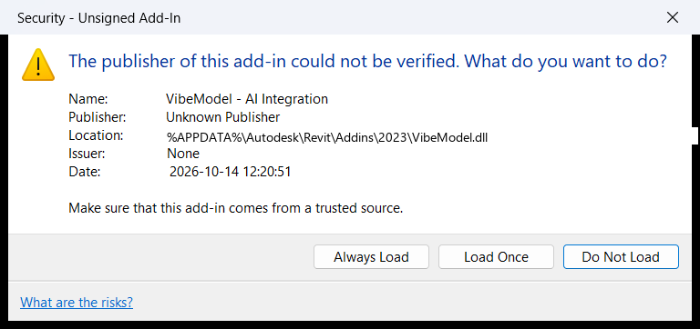
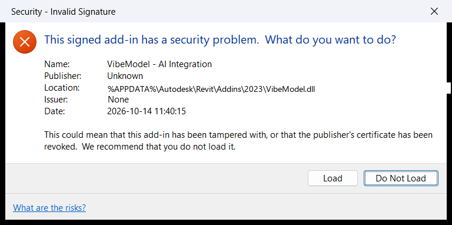
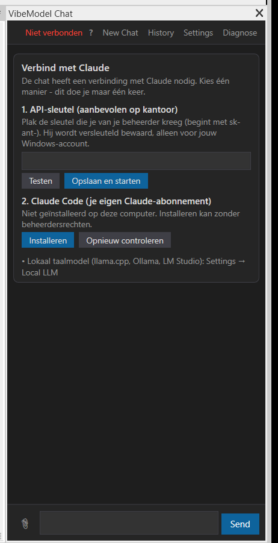
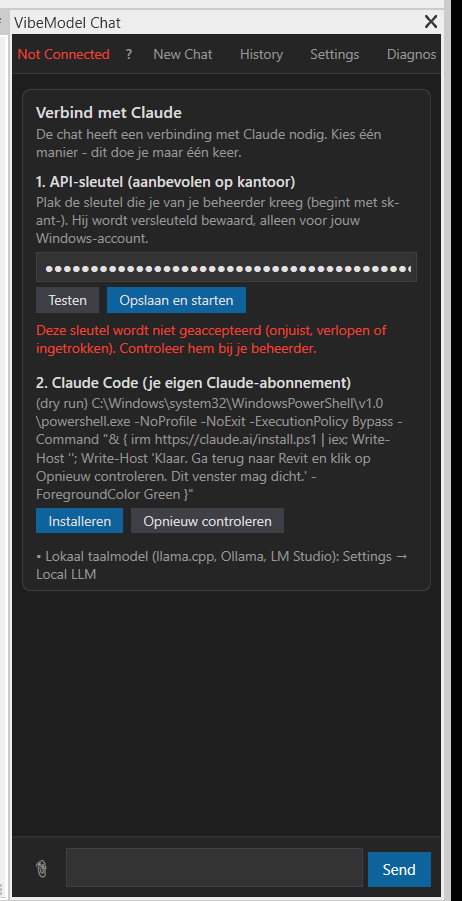
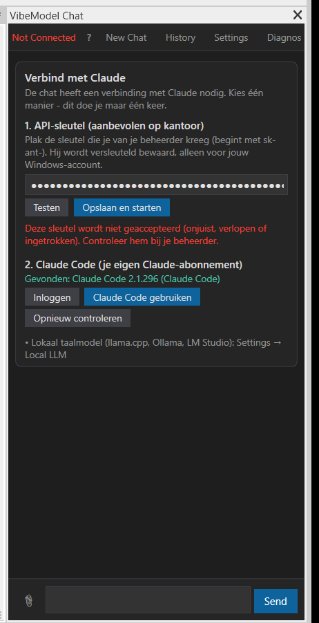

# Onboarding for non-programmers — verification, 2026-10-14

What a modeller without administrator rights sees from the zip to the first answer, tested as a
fresh user on Revit 2023 / Windows 11 (Dutch UI language). User paths are written as `%APPDATA%`
etc.; screenshots that show internal names are kept out of the repository
(`demo_out/onboarding-verify/`, gitignored).

## Summary

| Area | Result |
|---|---|
| Unit tests | **1151 / 1151 pass** (52 new: settings/DPAPI/managed, CLI discovery, proxy hand-over, TLS, pricing, screenshots, diagnose masking, mock-API end-to-end) |
| Installer, fresh user (sandboxed profile, 17 files marked "from the internet") | installs, unblocks all, verifies, exit 0 |
| Installer, second run | every file "already up to date", exit 0 |
| Installer, GitHub "Source code (zip)" | names the right download, exit 1 |
| Installer `-Quiet` while Revit runs | "Revit is running …", exit 2, no prompt |
| Installer, Revit 2023 + 2025 folders | installs into 2023 only, "Also found Revit 2025 - not touched" |
| Installer, zip for a Revit that is not installed | names what is missing, exit 3 |
| Revit, unsigned build | "Security - Unsigned Add-In" once per new build → *Always Load* |
| Revit, self-signed (untrusted) build | **"Security - Invalid Signature"** on every start → never ship this |
| Revit, trusted signature | **no dialog** |
| Chat pane, nothing configured | "Verbind met Claude" wizard |
| Wrong API key | "niet geaccepteerd" after the API answered 401; **not stored** |
| Install Claude Code button | starts the official per-user installer (verified in dry-run mode) |
| Claude Code found → "Claude Code gebruiken" | backend switches without restart; real answer + cost line |
| Diagnose (button and `/diagnose`) | full report, secrets masked; `/diagnose` 0.6 s |
| API backend with a **valid** key | **not tested live** — no API key on this machine (mock-API tests instead, see below) |

## 1. Installer (no Revit needed)

The release zip was expanded into a temp folder, every `.dll/.exe/.ps1/.cmd` was given a
`Zone.Identifier` (ZoneId=3, as a browser download does), and `APPDATA` / `LOCALAPPDATA` pointed at an
empty profile with `Autodesk\Revit\Addins\2023`.

First run (exactly what the user sees):

```
  VibeModel Installer
  ===================

  VibeModel 1.2.9.0
  Revit versions: 2023

  Revit 2023: %APPDATA%\Autodesk\Revit\Addins\2023
    installed VibeModel.dll
    installed VibeModel.addin
    installed Markdig.dll
    installed the VibeModel.PdfText helper (14 files)

  Files installed and unblocked.
  The add-in is not signed: the first time, Revit asks whether to load it - choose 'Always Load'.

  Done! Start Revit -> tab VibeModel -> Chat. The first time, the chat asks how to connect to Claude.

  Press Enter to close this window
```

Second run: `VibeModel.dll already up to date (v1.2.9.0)` (and the same for the other files), exit 0.
Every line also lands in `%LOCALAPPDATA%\VibeModel\logs\install.log` with a timestamp and the version.

From GitHub's source-code zip:

```
  This folder is the SOURCE CODE of VibeModel, not the add-in.
  The add-in (VibeModel.dll) is not in it.

  Download the file named  VibeModel-v<version>-Revit<year>.zip  under 'Assets' at
  https://github.com/Quincy987/VibeModel/releases/latest
  (not 'Source code (zip)'), unzip it and run install.cmd from there.
```

`-Quiet` with a process named `Revit` running: `Revit is running - close it and run the installer again.`, exit 2.
After the review the installer only installs into the Revit year in the zip's `revit-year.txt`: with
`Addins\2023` and `Addins\2025` present it installed into 2023 and printed
`Also found Revit 2025 - not touched: this build is for Revit 2023 only.`; with a year that is not
installed it stopped with exit 3. (The installer runs above predate this and say "Revit versions: 2023".)
All three PowerShell scripts parse without errors and are pure ASCII (Windows PowerShell 5.1 reads
BOM-less scripts as ANSI).

## 2. Revit's add-in security prompt, by signature

Measured by installing each build with the installer and starting Revit 2023 (my own instance,
started detached; Revit's remembered choice for VibeModel was removed first, as on a new laptop).

- **Unsigned** — once per new DLL (it came back after a rebuild):

  

- **Self-signed, not trusted** — signed with `scripts/sign.ps1`'s test certificate:

  

  Worse than unsigned: a red "may have been tampered with … we recommend that you do not load it",
  and no *Always Load*. Consequence: `package-release.ps1 -Sign` refuses without a real certificate
  (`-AllowSelfSigned` for tests only), and the installer does **not** offer to trust a certificate —
  adding a root makes Windows itself warn "Installatie van een certificaat met een niet-geverifieerde
  vingerafdruk is een beveiligingsrisico".
- **Signed and trusted** — the same test certificate placed in *Trusted Root* and *Trusted
  Publishers* for this user: Revit loaded VibeModel **without any dialog**. This is what a code-signing
  certificate from the office's own CA (deployed by IT) gives. The test certificate was removed from
  both stores (and from the personal store) afterwards.

## 3. The chat pane as a fresh user

Revit started with `VIBEMODEL_CLAUDE_CLI=none` (Claude Code installed on this PC, but hidden — as on a
laptop without it), no settings file, a small test model (temp copy, never saved).

**Wizard** — header in the pane's language, every button visible at the default pane width:



**Wrong key → Testen / Opslaan en starten** (run 1, before the header fix — hence "Not Connected"):



The API answered 401 from inside Revit (7.5 s including UI automation), the text says the key is not
accepted, and *Opslaan en starten* did not store it: no `settings.json` was created. The log line
masks the key: `key test InvalidKey (HTTP 401) for sk-ant-…0000`.

**Installeren** (dry-run mode `VIBEMODEL_DRY_RUN_INSTALL=1`, because Claude Code is already installed
here and this session itself runs on it):

```
C:\Windows\system32\WindowsPowerShell\v1.0\powershell.exe -NoProfile -NoExit -ExecutionPolicy Bypass -Command "& { irm https://claude.ai/install.ps1 | iex; Write-Host ''; Write-Host 'Klaar. Ga terug naar Revit en klik op Opnieuw controleren. Dit venster mag dicht.' -ForegroundColor Green }"
```

The command string parses without errors. A real install run was not done (see "not tested").

**Claude Code found → gebruiken** — VibeModel was pointed at the real CLI the way IT would (a
temporary `managed.json` with `ClaudeCliPath`, removed afterwards). *Opnieuw controleren* →
"Gevonden: Claude Code 2.1.296", then *Claude Code gebruiken*:



The pane switched to Claude Code at once (log: `connect wizard chose claude-cli` → `Backend switched
to: ClaudeCodeBackend`; `settings.json` = `{"PreferredBackend":"claude-cli"}`), showed the normal
welcome card, and a real question ("Wat zit er in dit model? Antwoord in maximaal 3 regels.") was
answered in about 10 s with **`31.0k tokens · ≈ €0,12`** under the answer. The CLI was started with
`--allowedTools Bash,PowerShell,Read,Grep,Glob`, so the CLI accepts the PowerShell tool name.

**Diagnose** — opened from the header; the report was ready when the window appeared, *Opslaan*
wrote `%LOCALAPPDATA%\VibeModel\logs\diagnose-20261014-1414.txt`. Content (user name replaced):

```
== VibeModel
Version: 1.2.9.0
Add-in: %APPDATA%\Autodesk\Revit\Addins\2023\VibeModel.dll
Signature: valid - VibeModel Dev (not for distribution)          (run 1: test certificate trusted)
Revit: 2023 · .NET 4.0.30319.42000 · Windows 10.0.26100.0
HTTP server: port 18884
== Chat backend
Preferred: auto
In use: Anthropic API · claude-sonnet-5-5 · NOT ready - <no key text>
API key: none
API endpoint: https://api.anthropic.com/v1/messages
Claude Code: not found
  checked: discovery switched off (ClaudeCliPath / VIBEMODEL_CLAUDE_CLI = none)
managed.json: none (looked in C:\ProgramData\VibeModel\managed.json, %APPDATA%\VibeModel\managed.json)
== Network
Windows proxy for the API: none (direct)
api.anthropic.com: DNS 160.79.104.10,… · HTTPS reachable (HTTP 401, 175 ms) · certificate issued by CN=WE1, O=Google Trust Services, C=US
claude.ai: DNS 160.79.104.10,… · HTTPS reachable (HTTP 403, 80 ms) · certificate issued by CN=YE2, O=Let's Encrypt, C=US
== Recent warnings and errors (this Revit session)
…
```

`curl http://127.0.0.1:18884/diagnose` returned the same report in 0.6 s; `?format=json` gives
`{"ok":true,"text":…}`.

**Settings → Anthropic API**: key box (empty — only the user's own key is ever shown), *Validate*,
*Model (empty = claude-sonnet-5-5)*, *API endpoint (advanced)*. Closed without saving.

Found and fixed during the run: the header said "Not Connected" in English and cut off *Diagnose* at
the default pane width; then the squeezed title left a stray "V…". Now the status is localized
("Niet verbonden"), trims, and the title fades out when it does not fit. (The title's width check was
rewritten in review; the re-run below shows that version.)

## 5. Re-run after the reviews (commit 898d898)

Same fresh-user setup, zip rebuilt from the reviewed code, one Revit 2023 started for it:

- Installer: "Installing for Revit 2023", unsigned note "asks once … (again after each update)"; Revit
  showed "Security - Unsigned Add-In" once → *Always Load*.
- Header: no stray "V…" title, every button visible (screenshot 1 above is from this run).
- Wizard, wrong key, *Testen* pressed and then *Opslaan en starten* / *Testen* again at once: exactly one
  key check ran (log: `key test InvalidKey (HTTP 401)`) — the buttons are disabled while it runs, so the
  extra presses were refused; status "niet geaccepteerd"; no settings.json written.
- Settings → *Validate* with a key in the box and `https://no-such-host.vibemodel-test.invalid` typed as
  endpoint: "no-such-host.vibemodel-test.invalid is niet bereikbaar: The remote name could not be
  resolved …" (the typed endpoint was tested and named). Endpoint box emptied: the default API answered
  401 → "niet geaccepteerd". Closed without saving: still no settings.json.
- TLS: after these HTTPS calls, `exec` read Revit's process-wide
  `ServicePointManager.SecurityProtocol` = `SystemDefault` — VibeModel no longer narrows it.
- `/diagnose`: "Nog niet verbonden met Claude. Gebruik de kaart Verbind met Claude …", API reachable
  (HTTP 401, 203 ms). No ERROR lines in the session log.
- Not exercised: the Enter-key path of the double-check guard (pressing keys would need focus on the
  user's desktop), and the screenshot/thinking changes of the API backend (no API key; mock tests).

## 4. The API backend without a key: mock Messages API

No Anthropic API key exists on this machine, so the reworked direct backend was run end to end
against a local mock of the Messages API (`ApiBaseUrl` → `http://127.0.0.1:<port>`): the real
HttpClient, the real SSE parser, the real tool loop (`DirectBackendStreamTests`):

- a streamed `thinking` block (empty text + `signature_delta`) is sent back unchanged before the
  `tool_use` in the next request; no empty text block; the `system` prompt is byte-identical within
  the turn; usage summed over both calls (2200 in / 50 out);
- a 400 "Invalid `signature` in `thinking` block" → one retry with the thinking blocks removed
  (tool call kept) → the answer arrives;
- `stop_reason: refusal` → the user sees the refusal text instead of an empty answer;
- a changed system prompt on the next turn → the earlier turn's thinking is not sent again.

## Not tested here (and why)

- **A real answer through the API backend** — no API key on this machine. First real-key user is the
  live test; the mock tests above cover the request shapes.
- **Running the Claude Code installer and its login for real** — Claude Code is already installed on
  this PC and this verification session runs on it; reinstalling could break the session.
- **A laptop without Git for Windows** (Claude Code on its PowerShell tool) — Git is installed here.
  Covered: the CLI accepts `PowerShell` in `--allowedTools`, and the prompt tells it to use `curl.exe`.
- **An office proxy / TLS inspection / AppLocker** — this machine goes direct. Diagnose shows the
  proxy and the certificate issuer, so the first office laptop will show where it stands.
- **A key from `managed.json` / `ANTHROPIC_API_KEY` in Settings** (locked field) — covered by unit
  tests, not looked at on screen.

## Machine state

Everything changed for the test was restored and checked by hash: `settings.json`, the deployed
add-in files, Revit's remembered *Always Load* for VibeModel (registry export/import), the temporary
`managed.json` removed, the test certificate removed from Trusted Root, Trusted Publishers and the
personal store. Each Revit instance was started by me and closed by its pid only.
